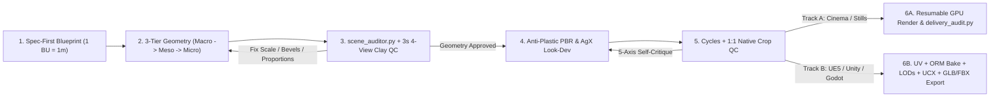

# Blender Programmatic Studio

**Ultra-detailed photorealistic 3D modeling, physical PBR look-dev, real-time game-ready asset production (UE5 / Unity / Godot / WebGL), and cinema rendering — driven 100% by Python scripts in headless Blender CLI (`4.2 LTS – 5.2+`), engineered for ANY AI agent.**

[English](./README.md) | [简体中文](./README_zh.md)


> **Real-world benchmark above**: Built and rendered end-to-end via headless Python scripts in Blender 5.2 LTS + Cycles OptiX GPU — zero manual GUI modeling. Includes procedural architecture, behind-glass interior rooms, 12-bucket skyline instancing, damp clearcoat coastal granite, dual-stage optical glare, and a beat-locked Workbench clay-to-Cycles transition.


---

## Dual-Track Closed-Loop Pipeline (Cinema + Real-Time Game Assets)

Most AI-generated Blender scripts fail in predictable ways: sharp 90° toy primitives, floating objects, uniform plastic roughness, black-metal Cycles bakes, unapplied non-unit scales that break UE5/Unity imports, Blender 4.x/5.x API crashes, and blind rendering.

**Blender Programmatic Studio** turns any coding or multimodal AI agent into a disciplined Technical Art Director with **two production tracks sharing one verified geometry & PBR core**:



---

## One-Command Cross-Agent Install (No Blender MCP Required)

Everything runs over **standard headless Blender CLI (`blender -b --factory-startup --python-exit-code 1 --python ...`)** with **zero external dependencies inside Blender's Python** (`bpy` + bundled `numpy`):

```bash
git clone https://github.com/Jowitt13/blender-programmatic-cinema
./blender-programmatic-cinema/install/install.sh         # macOS / Linux
.\blender-programmatic-cinema\install\install.ps1        # Windows PowerShell
```

Default installs cleanly into:
- `~/.gemini/config/skills/blender-programmatic-studio` (**Antigravity**)
- `~/.claude/skills/blender-programmatic-studio` (**Claude Code**)
- `~/.agents/skills/blender-programmatic-studio` (**Codex, OpenCode, Gemini CLI, GitHub Copilot, Cursor**)

Options: `--agent antigravity|claude|agents|all`, `--project DIR` for a single repo, `--uninstall`. For **ChatGPT + local terminal, Windsurf, Cline**, or any custom agent, drop [adapters/UNIVERSAL_PROMPT.md](./adapters/UNIVERSAL_PROMPT.md) into your system prompt (or rely on root [AGENTS.md](./AGENTS.md) / [CLAUDE.md](./CLAUDE.md)).

---

## Repository Structure

```text
blender-programmatic-studio/
├── SKILL.md                                     # Core Agent Skill runbook & dual-track closed-loop protocol
├── AGENTS.md / CLAUDE.md                        # Root auto-discovery pointers for coding agents
├── README.md / README_zh.md                     # English & Chinese documentation
├── LICENSE                                      # MIT License
├── install/
│   ├── install.sh / install.ps1                 # One-command cross-platform, cross-agent installers
├── assets/
│   ├── chiba_clay_to_cycles_showcase.jpg        # 3-stage procedural Clay -> Cycles -> 135mm telephoto showcase
│   └── chiba_clay_vs_cycles_split.jpg           # Exact matched-camera Frame 149 vs 150 split comparison
├── adapters/
│   └── UNIVERSAL_PROMPT.md                      # Drop-in prompt & CLI protocol for any agent
├── references/
│   ├── photoreal-modeling-architecture.md       # Spec-first scale, Macro->Meso->Micro law, behind-glass depth
│   ├── pbr-materials-and-realism.md             # Anti-plastic PBR cookbook, multi-scale roughness/AO, IOR/albedo table
│   ├── game-asset-and-realtime-pipeline.md      # UE5/Unity/Godot/WebGL: UVs, metallic-safe ORM bake, LODs, UCX collision
│   ├── cinematography-and-lighting-guide.md     # 5 scene lighting archetypes, AgX exposure, blue-hour & clay wipes
│   ├── blender-version-pitfalls.md              # 16 verified Blender 4.2–5.2 + Cycles GPU + FFmpeg 8+ fixes
│   └── aesthetic-direction-and-habits.md        # Director's eye, 5-axis self-critique rubric, anti-"AI slop" rules
├── scripts/
│   ├── blender_compat.py                        # Blender 4.2 LTS – 5.2+ shim (sky, compositor, actions, BSDF, EEVEE)
│   ├── optix_render_utils.py                    # Multi-backend GPU activator (OPTIX/CUDA/HIP/ONEAPI/METAL/CPU) + OIDN
│   ├── cinema_rig_kit.py                        # 5 --preset photoreal scene templates, aspect framing & compositor
│   ├── scene_auditor.py                         # Pre-render & --game-ready .blend auditor (scale, bevels, UVs, tris, PBR)
│   ├── visual_qc_kit.py                         # Zero-dependency 3s 4-view clay QC & Cycles 1:1 native crop diagnostic
│   ├── game_asset_pipeline.py                   # Unit scale, UV0/UV1, metallic-safe PBR->ORM bake, LODs, UCX & GLB/FBX/USD
│   ├── resumable_seq_renderer.py                # Resumable GPU sequence renderer with PNG IEND validation & --overwrite
│   └── delivery_audit.py                        # Still & MP4 delivery auditor (ffprobe, MAD continuity scan, storyboard)
├── examples/
│   └── 01_photoreal_architectural_bay.py        # Runnable gold-standard spec-first architectural bay + blue-hour render
└── tests/
    └── run_smoke_test.py                        # Cross-platform one-command regression & full Blender smoke test suite
```

---

## Quickstart (3-Minute End-to-End Run)

### 1. Build Gold-Standard Scene + Run Automated Audit + Clay & Cycles QC

```bash
blender -b --factory-startup --python-exit-code 1 --python examples/01_photoreal_architectural_bay.py -- \
  --out ./build/arch_bay.blend --samples 48

blender -b --factory-startup --python-exit-code 1 --python scripts/scene_auditor.py -- \
  --blend ./build/arch_bay.blend --fail-on-error

blender -b --factory-startup --python-exit-code 1 --python scripts/visual_qc_kit.py -- \
  --blend ./build/arch_bay.blend --mode clay_4view --out ./qc/clay_4view.png

blender -b --factory-startup --python-exit-code 1 --python scripts/visual_qc_kit.py -- \
  --blend ./build/arch_bay.blend --mode cycles_crop --out ./qc/cycles_qc.png --res 1024 --samples 32
```

### 2. Export as a Game-Ready UE5 / Unity / Godot / WebGL Asset (Baked ORM + LODs + Collision)

```bash
blender -b --factory-startup --python-exit-code 1 --python scripts/game_asset_pipeline.py -- \
  --blend ./build/arch_bay.blend --out-blend ./build/arch_bay_game.blend \
  --asset-name ArchBay --merge-hero --lightmap-uv --weighted-normals \
  --bake --tex-dir ./export/textures --tex-size 2048 --normal-format opengl \
  --lods 0.5,0.2 --collision \
  --export-glb ./export/ArchBay.glb --export-fbx ./export/ArchBay.fbx

blender -b --factory-startup --python-exit-code 1 --python scripts/scene_auditor.py -- \
  --blend ./build/arch_bay_game.blend --game-ready --fail-on-error
```

### 3. Scaffold Any Scene Preset or Run the Full Smoke Test Suite

```bash
# Presets: studio_product | arch_exterior | arch_interior | diorama_terrain | cinema_macro
blender -b --factory-startup --python-exit-code 1 --python scripts/cinema_rig_kit.py -- \
  --preset arch_exterior --out ./build/master_rig.blend --res-x 1920 --res-y 1920 --compositor

# Verify everything end-to-end on your installed Blender (4.2–5.2+)
python tests/run_smoke_test.py
```

---

## Ecosystem & Complementary Open-Source Projects

This workflow focuses on **spec-first photorealistic modeling, architectural/product/environment look-dev, automated closed-loop QC, metallic-safe PBR->ORM baking, and cinema/game export**. It pairs cleanly with:
- **[EL4CTEO/blender-skills](https://github.com/EL4CTEO/blender-skills)** — Broad 28-skill library great for specialized character tasks (Rigify rigging, ARKit 52 facial blendshapes, cloth/hair grooming, sculpting).
- **[ahujasid/camera-to-blender](https://github.com/ahujasid/camera-to-blender)** — Mobile photo -> Tripo3D mesh generator for rapidly capturing intricate real-world organic props, which can then be cleaned, unwrapped, LOD-decimated, and baked through our `scripts/game_asset_pipeline.py`.

---

## Prerequisites & License

- **Blender 4.2 LTS, 4.5 LTS, 5.0, or 5.2+ LTS** + GPU compute driver (`OptiX` / `CUDA` / `HIP` / `OneAPI` / `Metal` or CPU fallback)
- **Python 3** + **FFmpeg 8+** (for video mastering and `delivery_audit.py`)
- **MIT License** — see [LICENSE](./LICENSE).
