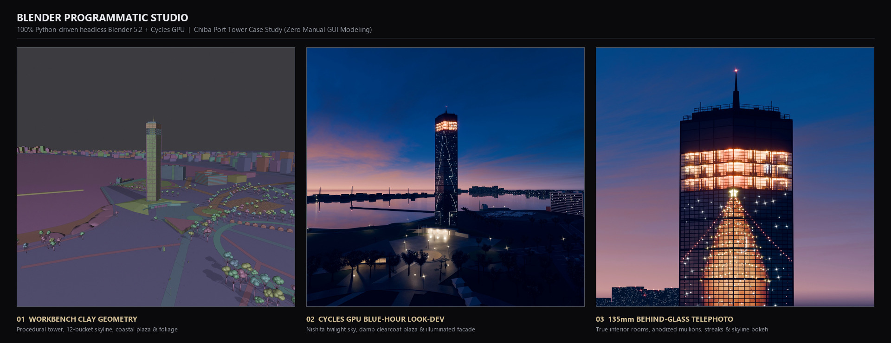
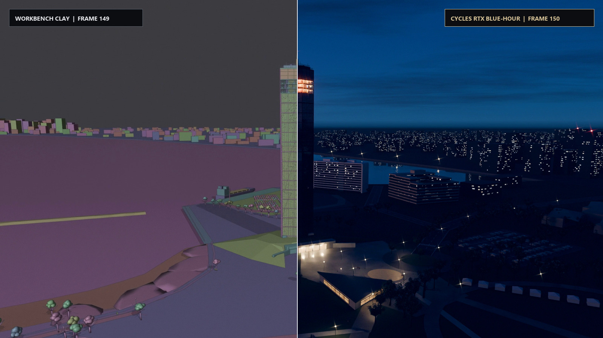
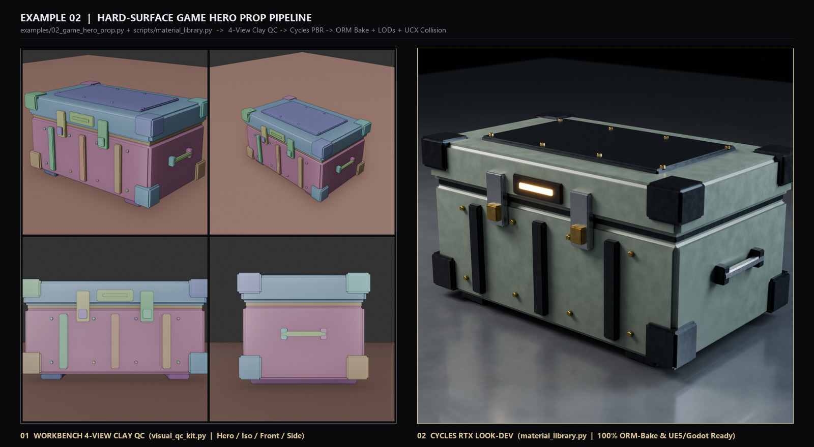
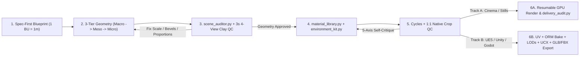

# Blender Programmatic Studio

[](https://github.com/Jowitt13/blender-programmatic-studio/actions/workflows/ci.yml)
[](https://github.com/Jowitt13/blender-programmatic-studio/releases)
[](https://www.blender.org/)
[](./LICENSE)

**Ultra-detailed photorealistic 3D modeling, one-line physical PBR shaders, real-time game-ready asset & environment pipelines (UE5 / Unity / Godot / WebGL), and Cycles GPU cinema rendering — driven 100% by Python scripts in headless Blender CLI, engineered for ANY AI agent.**

[English](./README.md) | [简体中文](./README_zh.md)



> **Real-world benchmark above**: Built and rendered end-to-end via headless Python scripts in Blender 5.2 LTS + Cycles OptiX GPU — zero manual GUI modeling. Includes procedural architecture, behind-glass interior rooms, 12-bucket skyline instancing, damp clearcoat coastal granite, dual-stage optical glare, and a beat-locked Workbench clay-to-Cycles transition.



### Runnable Hard-Surface Game Prop Benchmark (`examples/02_game_hero_prop.py`)



> Built purely with `examples/02_game_hero_prop.py` + `scripts/material_library.py` in seconds, verified with `visual_qc_kit.py`, and directly exportable to UE5/Unity/Godot with baked `BaseColor + ORM + Normal + Emissive`, LOD0/1/2, and `UCX_` collision.

---

## Dual-Track Closed-Loop Pipeline (Cinema + Real-Time Game Assets)



---

## One-Command Cross-Agent Install (No Blender MCP Required)

Everything runs over **standard headless Blender CLI (`blender -b --factory-startup --python-exit-code 1 --python ...`)** with **zero external dependencies inside Blender's Python** (`bpy` + bundled `numpy`):

**Claude Code Plugin (Native Marketplace)**:
```text
/plugin marketplace add Jowitt13/blender-programmatic-studio
/plugin install blender-programmatic-studio@blender-programmatic-studio
```

**Any Agent (Antigravity, Claude Code, Codex, OpenCode, Gemini CLI, Copilot, Cursor)**:
```bash
git clone https://github.com/Jowitt13/blender-programmatic-studio
./blender-programmatic-studio/install/install.sh         # macOS / Linux
.\blender-programmatic-studio\install\install.ps1        # Windows PowerShell
```

Default installs cleanly into `~/.gemini/config/skills`, `~/.claude/skills`, and `~/.agents/skills`. Options: `--agent antigravity|claude|agents|all`, `--project DIR`, `--uninstall`. For **ChatGPT + terminal, Windsurf, Cline**, drop [adapters/UNIVERSAL_PROMPT.md](./adapters/UNIVERSAL_PROMPT.md) into your system prompt (or use root [AGENTS.md](./AGENTS.md) / [CLAUDE.md](./CLAUDE.md)).

---

## Repository Structure

```text
blender-programmatic-studio/
├── SKILL.md                                     # Core Agent Skill runbook & dual-track closed-loop protocol
├── AGENTS.md / CLAUDE.md                        # Root auto-discovery pointers for coding agents
├── README.md / README_zh.md / CHANGELOG.md      # English & Chinese docs + release history
├── .claude-plugin/                              # Native Claude Code plugin & marketplace manifests
├── .github/workflows/ci.yml                     # Automated GitHub Actions validation & installer CI
├── install/install.sh & install.ps1             # One-command cross-platform, cross-agent installers
├── assets/                                      # Chiba Port Tower & Game Prop real rendered benchmarks
├── adapters/UNIVERSAL_PROMPT.md                 # Drop-in prompt & CLI protocol for any agent
├── references/
│   ├── photoreal-modeling-architecture.md       # Spec-first scale, Macro->Meso->Micro law, behind-glass depth
│   ├── pbr-materials-and-realism.md             # Anti-plastic PBR cookbook, multi-scale roughness/AO, IOR/albedo table
│   ├── game-asset-and-realtime-pipeline.md      # UE5/Unity/Godot/WebGL: UVs, metallic-safe ORM bake, LODs, UCX collision
│   ├── cinematography-and-lighting-guide.md     # 5 scene lighting archetypes, AgX exposure, blue-hour & clay wipes
│   ├── blender-version-pitfalls.md              # 16 verified Blender 4.2–5.2 + Cycles GPU + FFmpeg 8+ fixes
│   └── aesthetic-direction-and-habits.md        # Director's eye, 5-axis self-critique rubric, anti-"AI slop" rules
├── scripts/
│   ├── blender_compat.py                        # Blender 4.2 LTS – 5.2+ shim (sky, compositor, actions, BSDF, EEVEE)
│   ├── optix_render_utils.py                    # Multi-backend GPU activator (OPTIX/CUDA/HIP/ONEAPI/METAL/CPU) + OIDN
│   ├── material_library.py                      # 16 one-line physical anti-plastic PBR materials (100% ORM-bake safe)
│   ├── environment_kit.py                       # 5 weather presets, bounded volumetric fog, procedural terrain & scatter
│   ├── cinema_rig_kit.py                        # 5 --preset photoreal scene templates, aspect framing & compositor
│   ├── scene_auditor.py                         # Pre-render & --game-ready .blend auditor (scale, bevels, UVs, tris, PBR)
│   ├── visual_qc_kit.py                         # Zero-dependency 3s 4-view clay QC & Cycles 1:1 native crop diagnostic
│   ├── game_asset_pipeline.py                   # Unit scale, UV0/UV1, metallic-safe PBR->ORM bake, LODs, UCX & GLB/FBX/USD
│   ├── cleanup_imported_mesh.py                 # Clean AI-generated/scanned .glb/.fbx/.obj into game-ready engine assets
│   ├── resumable_seq_renderer.py                # Resumable GPU sequence renderer with PNG IEND validation & --overwrite
│   └── delivery_audit.py                        # Still & MP4 delivery auditor (ffprobe, MAD continuity scan, storyboard)
├── examples/
│   ├── 01_photoreal_architectural_bay.py        # Spec-first 3-tier architectural curtain wall + blue-hour render
│   └── 02_game_hero_prop.py                     # Hard-surface armored game supply crate using material_library.py
└── tests/run_smoke_test.py                      # Cross-platform one-command regression & full Blender smoke test suite
```

---

## Quickstart

### 1. Build & Bake a Game-Ready Hard-Surface Hero Prop (UE5 / Unity / Godot)

```bash
blender -b --factory-startup --python-exit-code 1 --python examples/02_game_hero_prop.py -- \
  --out ./build/game_crate.blend --samples 64

blender -b --factory-startup --python-exit-code 1 --python scripts/visual_qc_kit.py -- \
  --blend ./build/game_crate.blend --mode clay_4view --out ./qc/crate_clay.png

blender -b --factory-startup --python-exit-code 1 --python scripts/game_asset_pipeline.py -- \
  --blend ./build/game_crate.blend --out-blend ./build/game_crate_ready.blend \
  --asset-name SupplyCrate --merge-hero --lightmap-uv --weighted-normals \
  --bake --bake-emissive --tex-dir ./export/textures --tex-size 2048 --normal-format opengl \
  --lods 0.5,0.2 --collision \
  --export-glb ./export/SupplyCrate.glb --export-fbx ./export/SupplyCrate.fbx

blender -b --factory-startup --python-exit-code 1 --python scripts/scene_auditor.py -- \
  --blend ./build/game_crate_ready.blend --game-ready --fail-on-error
```

### 2. Clean Up an AI-Generated or Scanned `.glb` Into a Game Asset

```bash
blender -b --factory-startup --python-exit-code 1 --python scripts/cleanup_imported_mesh.py -- \
  --input ./raw/tripo_scan.glb --asset-name HeroProp \
  --target-height 1.2 --target-tris 15000 --reunwrap --lightmap-uv \
  --lods 0.5,0.2 --collision --export-glb ./export/HeroProp_Clean.glb
```

### 3. Verify Everything End-to-End on Your Machine

```bash
python tests/run_smoke_test.py
```

---

## Ecosystem & Complementary Open-Source Projects

- **[EL4CTEO/blender-skills](https://github.com/EL4CTEO/blender-skills)** — Broad 28-skill library great for specialized character tasks (Rigify rigging, ARKit 52 facial blendshapes, cloth/hair grooming, sculpting).
- **[ahujasid/camera-to-blender](https://github.com/ahujasid/camera-to-blender)** — Mobile photo -> Tripo3D mesh generator for quickly capturing intricate real-world organic props, which can then be cleaned, unwrapped, LOD-decimated, and exported through our `scripts/cleanup_imported_mesh.py`.

---

## Prerequisites & License

- **Blender 4.2 LTS, 4.5 LTS, 5.0, or 5.2+ LTS** + GPU compute driver (`OptiX` / `CUDA` / `HIP` / `OneAPI` / `Metal` or CPU fallback)
- **Python 3** + **FFmpeg 8+** (for video mastering and `delivery_audit.py`)
- **MIT License** — see [LICENSE](./LICENSE).
