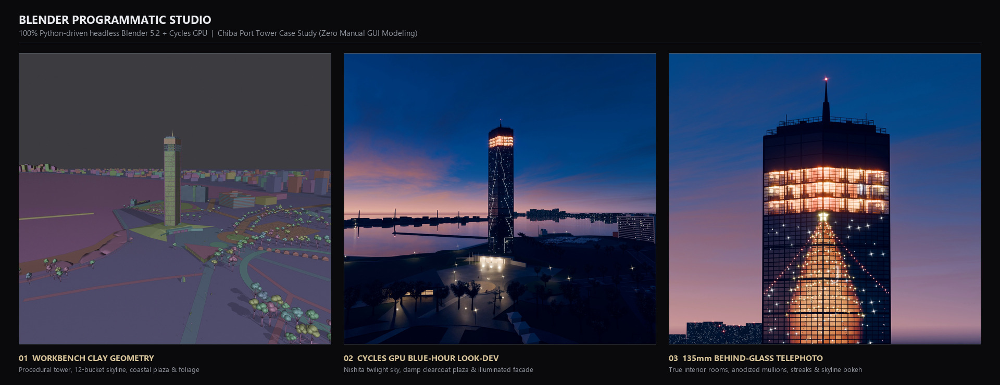
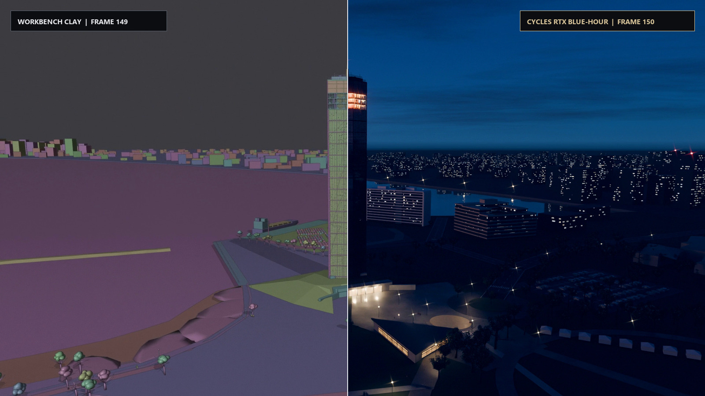
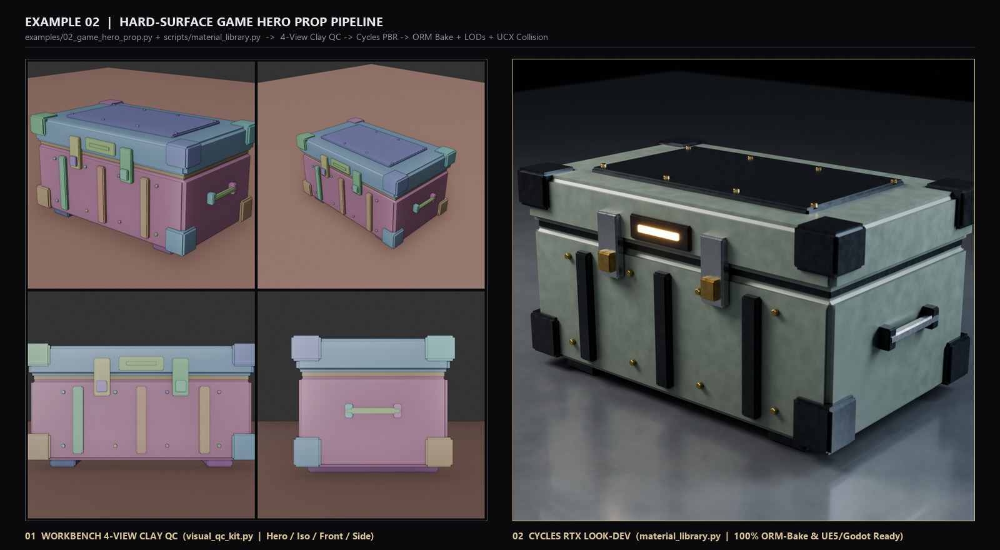
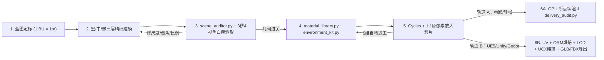

# Blender Programmatic Studio

[](https://github.com/Jowitt13/blender-programmatic-studio/actions/workflows/ci.yml)
[](https://github.com/Jowitt13/blender-programmatic-studio/releases)
[](https://www.blender.org/)
[](./LICENSE)

**让任何人、用任何 AI Agent 都能通过纯 Python 代码驱动 Blender（`4.2 LTS – 5.2+`）产出超精细、照片级拟真 3D 建模、一键物理 PBR 材质、实时游戏级资产与环境（UE5 / Unity / Godot / WebGL）以及电影级 Cycles GPU 渲染的开源工作流。**

[English](./README.md) | [简体中文](./README_zh.md)



> **上方实拍案例**：100% 由 AI Agent 通过无头 Python 脚本在 Blender 5.2 LTS + Cycles OptiX GPU 下构建并渲染（零手动 GUI 建模）。涵盖程序化建筑幕墙与真内透室内空间、12 色组城市天际线实例化、湿润花岗岩清漆反光、双级光学眩光，以及同机位无缝 Workbench 白模→蓝调成片过渡。



### 可复现硬表面游戏道具样板（`examples/02_game_hero_prop.py`）



> 基于 `examples/02_game_hero_prop.py` + `scripts/material_library.py` 全程序化秒级构建，经 `visual_qc_kit.py` 质检后可直接烘焙 `BaseColor + ORM + Normal + Emissive`、生成 LOD 与 `UCX_` 碰撞体并导出 `.glb`/`.fbx` 进游戏引擎。

---

## 电影级渲染 + 游戏资产全流程双轨架构



---

## 一行命令全平台 Agent 安装（无需 Blender MCP）

**Claude Code 原生插件市场直装**：
```text
/plugin marketplace add Jowitt13/blender-programmatic-studio
/plugin install blender-programmatic-studio@blender-programmatic-studio
```

**通用跨 Agent 安装（Antigravity / Claude Code / Codex / OpenCode / Gemini CLI / Copilot / Cursor）**：
```bash
git clone https://github.com/Jowitt13/blender-programmatic-studio
./blender-programmatic-studio/install/install.sh         # macOS / Linux
.\blender-programmatic-studio\install\install.ps1        # Windows PowerShell
```

默认自动安装到 `~/.gemini/config/skills`、`~/.claude/skills` 与 `~/.agents/skills`（支持 `--agent`、`--project DIR`、`--uninstall`）。若使用 **ChatGPT + 本地终端、Windsurf、Cline**，复制 [adapters/UNIVERSAL_PROMPT.md](./adapters/UNIVERSAL_PROMPT.md) 即可。

---

## 核心模块一览

- **一行代码物理材质工厂（[scripts/material_library.py](./scripts/material_library.py)）**：内置 16 种反塑料感、100% 适配 ORM 烘焙的物理 PBR 材质（风化混凝土、雨湿沥青、湿花岗岩、阳极氧化铝、拉丝钢、做旧黄铜、工业烤漆、锈铁、幕墙玻璃、静水、胡桃木、哑光灰泥、苔石、釉瓷、树叶、暖色自发光），支持线性调色与基于 `Normal.Z` 的顶面积雪覆盖。
- **游戏画面氛围与地形引擎（[scripts/environment_kit.py](./scripts/environment_kit.py)）**：内置 5 种天气光照预设（`blue_hour` / `rainy_night` / `golden_haze` / `snow_dusting` / `overcast_nordic`）、有界体积雾（避免 Cycles 无限体积噪点）、程序化海岛/山地网格生成器与按坡度/海拔筛选的实例散布器。
- **游戏资产烘焙、导出与 AI 网格洗白**
  - [scripts/game_asset_pipeline.py](./scripts/game_asset_pipeline.py)：单位缩放、底面轴心、`UV0 + Lightmap UV1`、`WeightedNormal`、**防金属变黑 PBR → ORM 打包烘焙**（`opengl`/`directx` 法线）、自动 `LOD1/LOD2`、UE5 `UCX_` 碰撞体与 `.glb`/`.fbx`/`.usdc` 导出。
  - [scripts/cleanup_imported_mesh.py](./scripts/cleanup_imported_mesh.py)：将 Tripo3D、`camera-to-blender`、Meshy 或实拍扫描导出的 `.glb`/`.fbx`/`.obj` 脏网格一键焊接清理、修复法线、真实身高归一化、按目标三角面数减面、重展 UV、补 LOD 与 `UCX_` 碰撞体。
- **零外部依赖自检闭环 & Blender 4.2–5.2+ 兼容层**：[scripts/blender_compat.py](./scripts/blender_compat.py)、[scripts/scene_auditor.py](./scripts/scene_auditor.py)（含 `--game-ready`）、[scripts/visual_qc_kit.py](./scripts/visual_qc_kit.py)、[scripts/resumable_seq_renderer.py](./scripts/resumable_seq_renderer.py)、[scripts/delivery_audit.py](./scripts/delivery_audit.py)。

---

## 3 分钟端到端体验

```bash
# 1. 构建硬表面游戏英雄道具并生成 4 视角白模验形图
blender -b --factory-startup --python-exit-code 1 --python examples/02_game_hero_prop.py -- \
  --out ./build/game_crate.blend --samples 64
blender -b --factory-startup --python-exit-code 1 --python scripts/visual_qc_kit.py -- \
  --blend ./build/game_crate.blend --mode clay_4view --out ./qc/crate_clay.png

# 2. 烘焙 BaseColor / ORM / Normal / Emissive、生成 LOD 与 UCX 碰撞体并导出 GLB/FBX
blender -b --factory-startup --python-exit-code 1 --python scripts/game_asset_pipeline.py -- \
  --blend ./build/game_crate.blend --out-blend ./build/game_crate_ready.blend \
  --asset-name SupplyCrate --merge-hero --lightmap-uv --weighted-normals \
  --bake --bake-emissive --tex-dir ./export/textures --tex-size 2048 --normal-format opengl \
  --lods 0.5,0.2 --collision \
  --export-glb ./export/SupplyCrate.glb --export-fbx ./export/SupplyCrate.fbx

# 3. 洗白外部 AI 生成或扫描模型为游戏资产
blender -b --factory-startup --python-exit-code 1 --python scripts/cleanup_imported_mesh.py -- \
  --input ./raw/tripo_scan.glb --asset-name HeroProp \
  --target-height 1.2 --target-tris 15000 --reunwrap --lightmap-uv \
  --lods 0.5,0.2 --collision --export-glb ./export/HeroProp_Clean.glb

# 4. 运行本机全量回归测试（含全部 16 材质、环境引擎、烘焙、洗白与导出）
python tests/run_smoke_test.py
```

---

## 开源生态与互补项目

- **[EL4CTEO/blender-skills](https://github.com/EL4CTEO/blender-skills)** — 涵盖 28 个细粒度 Skill，适合需要专门做角色骨骼绑定（Rigify）、ARKit 52 面部形态键、服装布料与雕刻的场景。
- **[ahujasid/camera-to-blender](https://github.com/ahujasid/camera-to-blender)** — 手机实拍转 Tripo3D 网格工具，适合快速采集复杂异形实拍道具白模，再接入本项目的 `scripts/cleanup_imported_mesh.py` 做游戏化洗白、UV、LOD、碰撞体与导出。

---

## 开源协议

本项目基于 MIT 协议开源，详见 [LICENSE](./LICENSE)。
