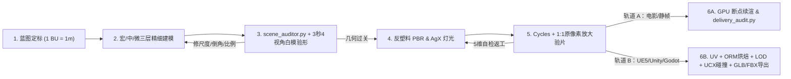

# Blender Programmatic Studio

**让任何人、用任何 AI Agent 都能通过纯 Python 代码驱动 Blender（`4.2 LTS – 5.2+`）产出超精细、照片级拟真 3D 建模、游戏级实时资产（UE5 / Unity / Godot / WebGL）与电影级 Cycles GPU 渲染的开源工作流。**

[English](./README.md) | [简体中文](./README_zh.md)


> **上方实拍案例**：100% 由 AI Agent 通过无头 Python 脚本在 Blender 5.2 LTS + Cycles OptiX GPU 下构建并渲染（零手动 GUI 建模）。涵盖程序化建筑幕墙与真内透室内空间、12 色组城市天际线实例化、湿润花岗岩清漆反光、双级光学眩光，以及同机位无缝 Workbench 白模→蓝调成片过渡。


---

## 电影级渲染 + 游戏资产全流程双轨架构

直接让通用 AI 写 Blender 脚本常踩同一批坑：锐利 90° 玩具方块、悬空穿模、塑料感均一粗糙度、Cycles 烘焙金属变黑、未应用缩放导致 UE5/Unity 导入错乱、Blender 4.x/5.x API 报错以及盲渲浪费算力。

**Blender Programmatic Studio** 以同一套「蓝图定标 + 三层建模 + 自动体检 + 视觉自检」为核心，打通 **电影/静帧精渲** 与 **实时游戏引擎资产交付** 两条完整产线：



---

## 一行命令全平台 Agent 安装（无需 Blender MCP）

整套工具基于 **标准无头 Blender CLI（`blender -b --factory-startup --python-exit-code 1 --python ...`）**，所有 Blender 内部脚本**零外部依赖**（仅用 `bpy` 与自带 `numpy`）：

```bash
git clone https://github.com/Jowitt13/blender-programmatic-studio
./blender-programmatic-studio/install/install.sh         # macOS / Linux
.\blender-programmatic-studio\install\install.ps1        # Windows PowerShell
```

默认自动安装到三大通用路径：
- `~/.gemini/config/skills/blender-programmatic-studio`（**Antigravity**）
- `~/.claude/skills/blender-programmatic-studio`（**Claude Code**）
- `~/.agents/skills/blender-programmatic-studio`（**Codex / OpenCode / Gemini CLI / GitHub Copilot / Cursor**）

支持参数：`--agent antigravity|claude|agents|all`、`--project DIR`（仅安装到单个项目）、`--uninstall`。若使用 **ChatGPT + 本地终端、Windsurf、Cline**，直接复制 [adapters/UNIVERSAL_PROMPT.md](./adapters/UNIVERSAL_PROMPT.md) 作为系统提示词即可（仓库根目录也内置了 [AGENTS.md](./AGENTS.md) 与 [CLAUDE.md](./CLAUDE.md)）。

---

## 核心能力模块

- **超精细建模与 PBR 手册**（[photoreal-modeling-architecture.md](./references/photoreal-modeling-architecture.md)、[pbr-materials-and-realism.md](./references/pbr-materials-and-realism.md)）
  - 强制 `Spec-First` 真实尺度、宏/中/微三层细节、物理 Albedo 安全区间 `[0.015, 0.85]`、多尺度粗糙度、AO 缝隙做旧与建筑真内透。
- **游戏资产与实时引擎全流程**（[game-asset-and-realtime-pipeline.md](./references/game-asset-and-realtime-pipeline.md) + [scripts/game_asset_pipeline.py](./scripts/game_asset_pipeline.py)）
  - 自动应用单位缩放与底面中心轴心（`z=0`）、生成 `UV0` 与 `UVMap_Lightmap (UV1)`、加权法线（`WeightedNormal`）。
  - **防金属变黑烘焙引擎**：自动将程序化材质烘焙为 `BaseColor` + `Normal`（支持 `opengl` / `directx` UE5 绿通道翻转）+ 纯 NumPy 打包 **ORM 贴图**（`R=AO, G=Roughness, B=Metallic`），并按官方 `glTF Material Output` 规范回连材质。
  - 自动生成 `LOD1 / LOD2` 减面层级、UE5 规范 `UCX_<Name>` 凸包碰撞体，一键导出 `.glb` / `.fbx` / `.usdc`。
- **自动化体检 + 零依赖视觉自检闭环**
  - [scripts/scene_auditor.py](./scripts/scene_auditor.py)：支持常规预审与 `--game-ready` 游戏资产体检（三角面预算、未应用缩放、缺失 UV、未烘焙程序化材质警告）。
  - [scripts/visual_qc_kit.py](./scripts/visual_qc_kit.py)：零 Pillow 依赖，3 秒生成 Workbench 4 视角白模（`clay_4view`）及 Cycles 全局 + 双 `1:1` 原像素放大 + 曝光统计（`cycles_crop`）。
- **5 大拟真场景母版 + Blender 4.2–5.2+ 兼容层**
  - [scripts/cinema_rig_kit.py](./scripts/cinema_rig_kit.py)（`studio_product` / `arch_exterior` / `arch_interior` / `diorama_terrain` / `cinema_macro`）+ [scripts/blender_compat.py](./scripts/blender_compat.py)（屏蔽 Blender 4.2–5.2 在物理天空 `MULTIPLE_SCATTERING`/`NISHITA`、合成器节点组、插槽动画与 BSDF 端口上的差异）。

---

## 3 分钟端到端体验

```bash
# 1. 运行黄金样板，生成三层建筑幕墙蓝调场景
blender -b --factory-startup --python-exit-code 1 --python examples/01_photoreal_architectural_bay.py -- \
  --out ./build/arch_bay.blend --samples 48

# 2. 自动体检 + 3秒4视角白模验形 + Cycles 1:1 放大验片
blender -b --factory-startup --python-exit-code 1 --python scripts/scene_auditor.py -- \
  --blend ./build/arch_bay.blend --fail-on-error
blender -b --factory-startup --python-exit-code 1 --python scripts/visual_qc_kit.py -- \
  --blend ./build/arch_bay.blend --mode clay_4view --out ./qc/clay_4view.png
blender -b --factory-startup --python-exit-code 1 --python scripts/visual_qc_kit.py -- \
  --blend ./build/arch_bay.blend --mode cycles_crop --out ./qc/cycles_qc.png --res 1024 --samples 32

# 3. 转换为 UE5 / Unity / Godot 游戏资产（烘焙 ORM + LOD + UCX 碰撞体 + GLB/FBX 导出）并终验
blender -b --factory-startup --python-exit-code 1 --python scripts/game_asset_pipeline.py -- \
  --blend ./build/arch_bay.blend --out-blend ./build/arch_bay_game.blend \
  --asset-name ArchBay --merge-hero --lightmap-uv --weighted-normals \
  --bake --tex-dir ./export/textures --tex-size 2048 --normal-format opengl \
  --lods 0.5,0.2 --collision \
  --export-glb ./export/ArchBay.glb --export-fbx ./export/ArchBay.fbx

blender -b --factory-startup --python-exit-code 1 --python scripts/scene_auditor.py -- \
  --blend ./build/arch_bay_game.blend --game-ready --fail-on-error

# 4. 一键回归测试本机全套工作流（含 5 预设、烘焙、导出与体检）
python tests/run_smoke_test.py
```

---

## 开源生态与互补项目

本项目专注于 **高拟真程序化建筑/产品/环境建模、物理 PBR 材质、自动化自检闭环、防变黑 ORM 烘焙与电影/游戏资产导出**，并与以下优秀开源项目天然互补：
- **[EL4CTEO/blender-skills](https://github.com/EL4CTEO/blender-skills)** — 涵盖 28 个细粒度 Skill，适合需要专门做角色骨骼绑定（Rigify）、ARKit 52 面部形态键、服装布料与雕刻的场景。
- **[ahujasid/camera-to-blender](https://github.com/ahujasid/camera-to-blender)** — 手机实拍转 Tripo3D 网格工具，适合快速采集复杂异形实拍道具白模，再接入本项目的 `game_asset_pipeline.py` 做轴心归零、UV、LOD、碰撞体与 PBR 烘焙入库。

---

## 开源协议

本项目基于 MIT 协议开源，详见 [LICENSE](./LICENSE)。
